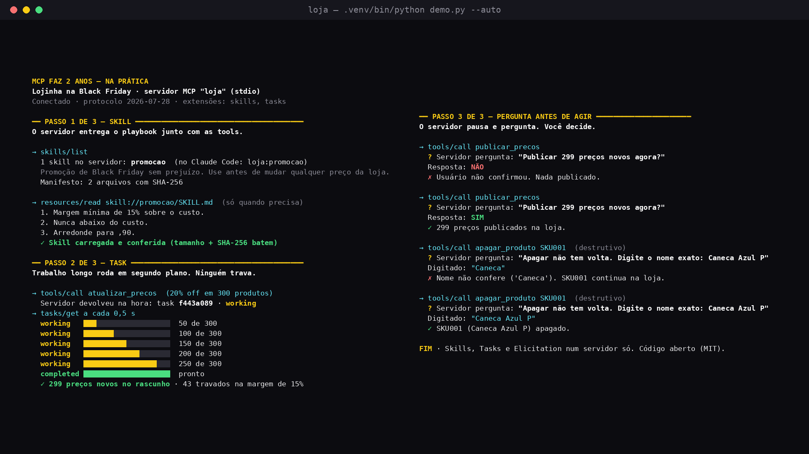

# MCP 2 in practice — the little shop on Black Friday

**Do you want to let AI change your store's prices without fear of breaking everything?** MCP turned 2 on 11/24/2026 and got what was missing for that: the AI receives the **playbook** together with the tools, slow work runs **in the background**, and the server **asks before acting**.

This kit shows all three working for real, in a small MCP server in Python, with a little shop of 300 products.

[Português](README.md) · [Español](README.es.md) · MIT License



## The 4 new features in one sentence

| Feature | What it is | Official status |
|---|---|---|
| **Skills over MCP** | The server ships skills (the playbook for using its tools) together with the tools; the AI only loads them when needed. | **Public beta.** Claude Code ≥ v2.1.331. Does not work in `claude -p`. |
| **Tasks** | Long work becomes a background task: the server returns a `taskId` right away and the client follows along. | **GA** (available) |
| **Elicitation** | The server pauses and asks the user: a form (yes/no, type the name) or a link for sensitive data outside the chat. | **GA** (available) |
| **File Uploads** | Sending a file to the MCP server. | **Not released yet** ("rolling out soon"). This kit only mentions it. |

## How to run (3 commands)

You need Python 3.10 or newer.

```bash
git clone https://github.com/inematds/mcp2-na-pratica && cd mcp2-na-pratica
python3 -m venv .venv && .venv/bin/pip install -r requirements.txt
.venv/bin/python demo.py --auto
```

Without `--auto`, the demo asks you (yes/no and the product name). To run the tests: `.venv/bin/python -m pytest -q`.

## Real demo output

The program speaks Brazilian Portuguese. Copied from [`exemplos/saida-demo.txt`](exemplos/saida-demo.txt) (colors stay in the terminal):

```text
MCP FAZ 2 ANOS — NA PRÁTICA
Lojinha na Black Friday · servidor MCP "loja" (stdio)
Conectado · protocolo 2026-07-28 · extensões: skills, tasks

━━ PASSO 1 DE 3 — SKILL ━━━━━━━━━━━━━━━━━━━━━━━━━━━━━━━━━━━━━━━
O servidor entrega o playbook junto com as tools.

→ skills/list
  1 skill no servidor: promocao  (no Claude Code: loja:promocao)
  Promoção de Black Friday sem prejuízo. Use antes de mudar qualquer preço da loja.
  Manifesto: 2 arquivos com SHA-256

→ resources/read skill://promocao/SKILL.md  (só quando precisa)
  1. Margem mínima de 15% sobre o custo.
  2. Nunca abaixo do custo.
  3. Arredonde para ,90.
  ✓ Skill carregada e conferida (tamanho + SHA-256 batem)

━━ PASSO 2 DE 3 — TASK ━━━━━━━━━━━━━━━━━━━━━━━━━━━━━━━━━━━━━━━━
Trabalho longo roda em segundo plano. Ninguém trava.

→ tools/call atualizar_precos  (20% off em 300 produtos)
  Servidor devolveu na hora: task f443a089 · working
→ tasks/get a cada 0,5 s
  working   ███░░░░░░░░░░░░░░░░░  50 de 300
  working   ███████░░░░░░░░░░░░░  100 de 300
  working   ██████████░░░░░░░░░░  150 de 300
  working   █████████████░░░░░░░  200 de 300
  working   █████████████████░░░  250 de 300
  completed ████████████████████  pronto
  ✓ 299 preços novos no rascunho · 43 travados na margem de 15%

━━ PASSO 3 DE 3 — PERGUNTA ANTES DE AGIR ━━━━━━━━━━━━━━━━━━━━━━
O servidor pausa e pergunta. Você decide.

→ tools/call publicar_precos
  ? Servidor pergunta: "Publicar 299 preços novos agora?"
  Resposta: NÃO
  ✗ Usuário não confirmou. Nada publicado.

→ tools/call publicar_precos
  ? Servidor pergunta: "Publicar 299 preços novos agora?"
  Resposta: SIM
  ✓ 299 preços publicados na loja.

→ tools/call apagar_produto SKU001  (destrutivo)
  ? Servidor pergunta: "Apagar não tem volta. Digite o nome exato: Caneca Azul P"
  Digitado: "Caneca"
  ✗ Nome não confere ('Caneca'). SKU001 continua na loja.

→ tools/call apagar_produto SKU001  (destrutivo)
  ? Servidor pergunta: "Apagar não tem volta. Digite o nome exato: Caneca Azul P"
  Digitado: "Caneca Azul P"
  ✓ SKU001 (Caneca Azul P) apagado.

FIM · Skills, Tasks e Elicitation num servidor só. Código aberto (MIT).
```

In short: step 1 lists and reads the `promocao` skill (minimum 15% margin, never below cost, prices ending in ,90) and checks its SHA-256; step 2 turns the price update of 300 products into a task followed by polling; step 3 asks "Publish 299 new prices now?" (no → nothing published; yes → published) and requires typing the exact product name before deleting (wrong name → nothing deleted).

One PNG per step, ready for video (1920x1080): [`passo1-skill.png`](exemplos/passo1-skill.png), [`passo2-task.png`](exemplos/passo2-task.png), [`passo3-pergunta.png`](exemplos/passo3-pergunta.png).

## What's inside

| File | What for |
|---|---|
| `servidor.py` | MCP server "loja" (stdio): skill `promocao`, tools `atualizar_precos` (task), `publicar_precos` (yes/no question) and `apagar_produto` (type the name). |
| `skills/promocao/SKILL.md` | The playbook: minimum 15% margin, ,90 ending, never below cost. |
| `demo.py` | Client that starts the server and shows the 3 steps in the terminal. `--auto` answers by itself. |
| `loja_cliente.py` | The minimum client for skills and tasks (used by the demo and the tests). |
| `tests/` | 17 pytest tests, all against the real server (stdio). |
| `exemplos/produtos.csv` | 300 fictional products (generated by `exemplos/gerar_produtos.py`). |
| `ferramentas/terminal_png.py` | Turns the demo's colored output into a 1920x1080 PNG. |
| `COMO-LIGAR-NO-CLAUDE.md` | How to plug the server into Claude Code and see `loja:promocao` in `/skills` (in Portuguese). |

The server never changes `exemplos/produtos.csv`: it works on a copy in `trabalho/` (or in the folder set by the `LOJA_TRABALHO` variable).

## What the Python SDK `mcp` 2.3.0 already does (and what we wrote by hand)

Checked by reading the installed SDK code:

| Feature | In SDK 2.3.0? | How the kit handles it |
|---|---|---|
| Elicitation (form) | **Yes.** `Resolve` + `Elicit` work on the new protocol (2026-07-28: the question comes back as `input_required` and the client retries the request) and on the old one (question over the back channel). | Uses the SDK directly. Tested on both protocols. |
| Elicitation (url) | Yes (`ctx.elicit_url`). | Only mentioned: the shop asks for no sensitive data. |
| Extensions in general | Yes: `Extension`, `MethodBinding`, `intercept_tool_call` on the server; `ClientExtension` + `ResultClaim` on the client. | The base for the two extensions below. |
| Skills over MCP (`io.modelcontextprotocol/skills`) | **Not** included. | Written in `servidor.py` (`SkillsExtension`): `skills/list`, `skills/get`, files via `resources/read`, `resources/directory/read`, manifest with SHA-256 and size. |
| Tasks (`io.modelcontextprotocol/tasks`) | **Not** included (the SDK only has the old 2025-11-25 types). | Written in `servidor.py` (`TasksExtension`): `CreateTaskResult`, `tasks/get`, `tasks/update`, `tasks/cancel`. A client without the extension gets the result the old way, as the spec requires. |
| File Uploads | No (not released yet). | Only mentioned. |

## In Claude Code

See [COMO-LIGAR-NO-CLAUDE.md](COMO-LIGAR-NO-CLAUDE.md). We tested on Claude Code 2.1.332: the server connects over protocol 2026-07-28 and `/skills` lists `loja:promocao` (proof in [`exemplos/prova-claude-code.txt`](exemplos/prova-claude-code.txt)).

## The process, start to finish

Who does it: 🧠 person · ⚙️ script

1. 🧠 Clone the repository: `git clone https://github.com/inematds/mcp2-na-pratica`
2. ⚙️ Create the environment: `python3 -m venv .venv && .venv/bin/pip install -r requirements.txt`
3. ⚙️ (Optional) Rebuild the 300-product catalog: `.venv/bin/python exemplos/gerar_produtos.py`
4. ⚙️ Run the tests: `.venv/bin/python -m pytest -q`
5. ⚙️ Watch the demo: `.venv/bin/python demo.py --auto` (or without `--auto` to answer yourself)
6. 🧠 Plug into Claude Code: `claude mcp add loja -- $PWD/.venv/bin/python $PWD/servidor.py`, then `/mcp` and `/skills`
7. ⚙️ (For video) Generate the PNGs: `.venv/bin/python demo.py --auto --ritmo 0 > /tmp/demo-cor.txt && python3 ferramentas/terminal_png.py /tmp/demo-cor.txt exemplos/` (needs `pip install pillow`)

## Official sources

- Anthropic article: <https://claude.com/resources/articles/skills-over-mcp-tasks-and-more>
- MCP blog: <https://blog.modelcontextprotocol.io/posts/mcp-turns-two>
- MCP in Claude Code: <https://code.claude.com/docs/en/mcp>
- Skills extension: <https://modelcontextprotocol.io/extensions/skills/overview>
- Tasks extension: <https://modelcontextprotocol.io/extensions/tasks/overview>
- Elicitation (spec 2026-07-28): <https://modelcontextprotocol.io/specification/2026-07-28/client/elicitation>

## License

MIT. See [LICENSE](LICENSE). More kits like this one, free at inema.club, right on the internet.
