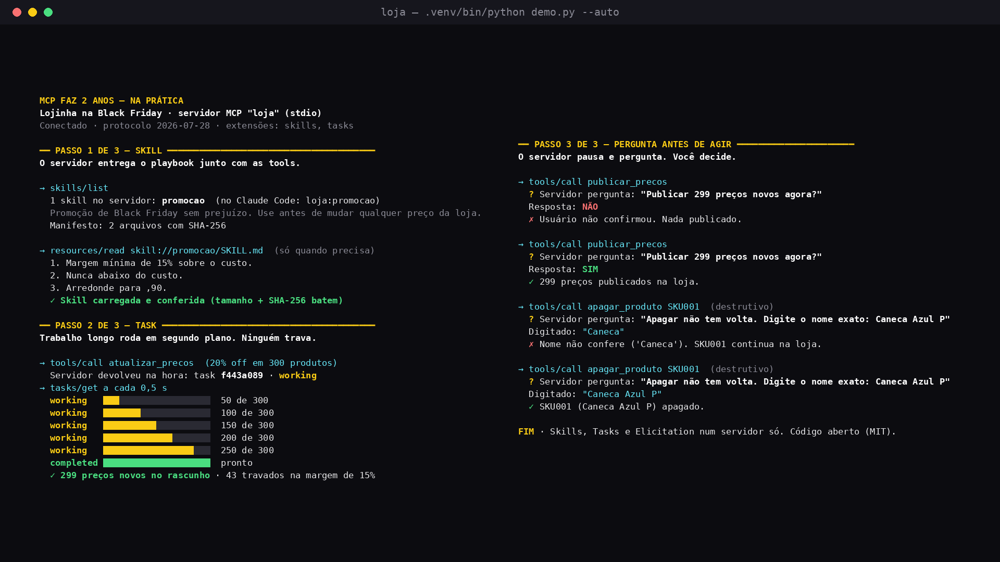

# MCP 2 en la práctica — la tiendita en el Black Friday

**¿Quieres dejar que la IA cambie los precios de tu tienda sin miedo a romper todo?** MCP cumplió 2 años el 24/11/2026 y ganó lo que faltaba para eso: la IA recibe el **playbook** junto con las herramientas, el trabajo lento corre **en segundo plano** y el servidor **pregunta antes de actuar**.

Este kit muestra las tres cosas funcionando de verdad, en un servidor MCP pequeño en Python, con una tiendita de 300 productos.

[Português](README.md) · [English](README.en.md) · Licencia MIT



## Las 4 novedades en una frase

| Novedad | Qué es | Estado oficial |
|---|---|---|
| **Skills over MCP** | El servidor entrega skills (el playbook de cómo usar sus tools) junto con las tools; la IA solo las carga cuando las necesita. | **Beta pública.** Claude Code ≥ v2.1.331. No funciona en `claude -p`. |
| **Tasks** | El trabajo largo se vuelve una tarea en segundo plano: el servidor devuelve un `taskId` al instante y el cliente le da seguimiento. | **GA** (disponible) |
| **Elicitation** | El servidor pausa y le pregunta al usuario: formulario (sí/no, escribe el nombre) o un enlace para datos sensibles fuera del chat. | **GA** (disponible) |
| **File Uploads** | Enviar un archivo al servidor MCP. | **Todavía no lanzado** ("rolling out soon"). Este kit solo lo menciona. |

## Cómo ejecutarlo (3 comandos)

Necesitas Python 3.10 o más reciente.

```bash
git clone https://github.com/inematds/mcp2-na-pratica && cd mcp2-na-pratica
python3 -m venv .venv && .venv/bin/pip install -r requirements.txt
.venv/bin/python demo.py --auto
```

Sin `--auto`, el demo te pregunta a ti (sí/no y el nombre del producto). Para correr las pruebas: `.venv/bin/python -m pytest -q`.

## Salida real del demo

El programa habla portugués de Brasil. Copiada de [`exemplos/saida-demo.txt`](exemplos/saida-demo.txt) (los colores se quedan en la terminal):

```text
MCP FAZ 2 ANOS — NA PRÁTICA
Lojinha na Black Friday · servidor MCP "loja" (stdio)
Conectado · protocolo 2026-07-28 · extensões: skills, tasks

━━ PASSO 1 DE 3 — SKILL ━━━━━━━━━━━━━━━━━━━━━━━━━━━━━━━━━━━━━━━
O servidor entrega o playbook junto com as tools.

→ skills/list
  1 skill no servidor: promocao  (no Claude Code: loja:promocao)
  Promoção de Black Friday sem prejuízo. Use antes de mudar qualquer preço da loja.
  Manifesto: 2 arquivos com SHA-256

→ resources/read skill://promocao/SKILL.md  (só quando precisa)
  1. Margem mínima de 15% sobre o custo.
  2. Nunca abaixo do custo.
  3. Arredonde para ,90.
  ✓ Skill carregada e conferida (tamanho + SHA-256 batem)

━━ PASSO 2 DE 3 — TASK ━━━━━━━━━━━━━━━━━━━━━━━━━━━━━━━━━━━━━━━━
Trabalho longo roda em segundo plano. Ninguém trava.

→ tools/call atualizar_precos  (20% off em 300 produtos)
  Servidor devolveu na hora: task f443a089 · working
→ tasks/get a cada 0,5 s
  working   ███░░░░░░░░░░░░░░░░░  50 de 300
  working   ███████░░░░░░░░░░░░░  100 de 300
  working   ██████████░░░░░░░░░░  150 de 300
  working   █████████████░░░░░░░  200 de 300
  working   █████████████████░░░  250 de 300
  completed ████████████████████  pronto
  ✓ 299 preços novos no rascunho · 43 travados na margem de 15%

━━ PASSO 3 DE 3 — PERGUNTA ANTES DE AGIR ━━━━━━━━━━━━━━━━━━━━━━
O servidor pausa e pergunta. Você decide.

→ tools/call publicar_precos
  ? Servidor pergunta: "Publicar 299 preços novos agora?"
  Resposta: NÃO
  ✗ Usuário não confirmou. Nada publicado.

→ tools/call publicar_precos
  ? Servidor pergunta: "Publicar 299 preços novos agora?"
  Resposta: SIM
  ✓ 299 preços publicados na loja.

→ tools/call apagar_produto SKU001  (destrutivo)
  ? Servidor pergunta: "Apagar não tem volta. Digite o nome exato: Caneca Azul P"
  Digitado: "Caneca"
  ✗ Nome não confere ('Caneca'). SKU001 continua na loja.

→ tools/call apagar_produto SKU001  (destrutivo)
  ? Servidor pergunta: "Apagar não tem volta. Digite o nome exato: Caneca Azul P"
  Digitado: "Caneca Azul P"
  ✓ SKU001 (Caneca Azul P) apagado.

FIM · Skills, Tasks e Elicitation num servidor só. Código aberto (MIT).
```

En resumen: el paso 1 lista y lee la skill `promocao` (margen mínimo de 15%, nunca por debajo del costo, precios terminados en ,90) y verifica su SHA-256; el paso 2 convierte la actualización de precios de 300 productos en una task seguida por polling; el paso 3 pregunta "¿Publicar 299 precios nuevos ahora?" (no → nada publicado; sí → publicado) y exige escribir el nombre exacto del producto antes de borrarlo (nombre equivocado → no se borra nada).

Un PNG por paso, listos para video (1920x1080): [`passo1-skill.png`](exemplos/passo1-skill.png), [`passo2-task.png`](exemplos/passo2-task.png), [`passo3-pergunta.png`](exemplos/passo3-pergunta.png).

## Qué hay adentro

| Archivo | Para qué |
|---|---|
| `servidor.py` | Servidor MCP "loja" (stdio): skill `promocao`, tools `atualizar_precos` (task), `publicar_precos` (pregunta sí/no) y `apagar_produto` (escribe el nombre). |
| `skills/promocao/SKILL.md` | El playbook: margen mínimo de 15%, terminación ,90, nunca por debajo del costo. |
| `demo.py` | Cliente que arranca el servidor y muestra los 3 pasos en la terminal. `--auto` responde solo. |
| `loja_cliente.py` | El mínimo de cliente para skills y tasks (usado por el demo y las pruebas). |
| `tests/` | 17 pruebas con pytest, todas contra el servidor real (stdio). |
| `exemplos/produtos.csv` | 300 productos ficticios (generados por `exemplos/gerar_produtos.py`). |
| `ferramentas/terminal_png.py` | Convierte la salida a color del demo en PNG 1920x1080. |
| `COMO-LIGAR-NO-CLAUDE.md` | Cómo conectar el servidor en Claude Code y ver `loja:promocao` en `/skills` (en portugués). |

El servidor nunca modifica `exemplos/produtos.csv`: trabaja sobre una copia en `trabalho/` (o en la carpeta de la variable `LOJA_TRABALHO`).

## Lo que el SDK de Python `mcp` 2.3.0 ya hace (y lo que escribimos a mano)

Verificado leyendo el código del SDK instalado:

| Recurso | ¿En el SDK 2.3.0? | Cómo lo resuelve el kit |
|---|---|---|
| Elicitation (form) | **Sí.** `Resolve` + `Elicit` funcionan en el protocolo nuevo (2026-07-28: la pregunta vuelve como `input_required` y el cliente repite el pedido) y en el antiguo (pregunta por el canal de vuelta). | Usa el SDK directamente. Probado en los dos protocolos. |
| Elicitation (url) | Sí (`ctx.elicit_url`). | Solo mencionado: la tiendita no pide datos sensibles. |
| Extensiones en general | Sí: `Extension`, `MethodBinding`, `intercept_tool_call` en el servidor; `ClientExtension` + `ResultClaim` en el cliente. | Es la base de las dos extensiones de abajo. |
| Skills over MCP (`io.modelcontextprotocol/skills`) | **No** viene incluida. | Escrita en `servidor.py` (`SkillsExtension`): `skills/list`, `skills/get`, archivos por `resources/read`, `resources/directory/read`, manifiesto con SHA-256 y tamaño. |
| Tasks (`io.modelcontextprotocol/tasks`) | **No** viene incluida (el SDK solo tiene los tipos antiguos de 2025-11-25). | Escrita en `servidor.py` (`TasksExtension`): `CreateTaskResult`, `tasks/get`, `tasks/update`, `tasks/cancel`. Un cliente sin la extensión recibe el resultado a la manera antigua, como exige la spec. |
| File Uploads | No (todavía no lanzado). | Solo mencionado. |

Límites honestos del kit: las tasks viven solo en la memoria del servidor (desaparecen si se reinicia), el `ttlMs` se informa pero no borra nada solo, y `tasks/update` solo confirma la recepción, porque `atualizar_precos` no pide nada a mitad del camino.

## En Claude Code

Mira [COMO-LIGAR-NO-CLAUDE.md](COMO-LIGAR-NO-CLAUDE.md). Probamos en Claude Code 2.1.332: el servidor se conecta por el protocolo 2026-07-28 y `/skills` lista `loja:promocao` (prueba en [`exemplos/prova-claude-code.txt`](exemplos/prova-claude-code.txt)).

## El proceso, de principio a fin

Quién lo hace: 🧠 persona · ⚙️ script

1. 🧠 Clonar el repositorio: `git clone https://github.com/inematds/mcp2-na-pratica`
2. ⚙️ Crear el entorno: `python3 -m venv .venv && .venv/bin/pip install -r requirements.txt`
3. ⚙️ (Opcional) Rehacer el catálogo de 300 productos: `.venv/bin/python exemplos/gerar_produtos.py`
4. ⚙️ Correr las pruebas: `.venv/bin/python -m pytest -q`
5. ⚙️ Ver el demo: `.venv/bin/python demo.py --auto` (o sin `--auto` para responder tú)
6. 🧠 Conectar en Claude Code: `claude mcp add loja -- $PWD/.venv/bin/python $PWD/servidor.py`, luego `/mcp` y `/skills`
7. ⚙️ (Para video) Generar los PNG: `.venv/bin/python demo.py --auto --ritmo 0 > /tmp/demo-cor.txt && python3 ferramentas/terminal_png.py /tmp/demo-cor.txt exemplos/` (necesita `pip install pillow`)

## Fuentes oficiales

- Artículo de Anthropic: <https://claude.com/resources/articles/skills-over-mcp-tasks-and-more>
- Blog de MCP: <https://blog.modelcontextprotocol.io/posts/mcp-turns-two>
- MCP en Claude Code: <https://code.claude.com/docs/en/mcp>
- Extensión Skills: <https://modelcontextprotocol.io/extensions/skills/overview>
- Extensión Tasks: <https://modelcontextprotocol.io/extensions/tasks/overview>
- Elicitation (spec 2026-07-28): <https://modelcontextprotocol.io/specification/2026-07-28/client/elicitation>

## Licencia

MIT. Mira [LICENSE](LICENSE). Más kits como este, gratis en inema.club, directo en internet.
