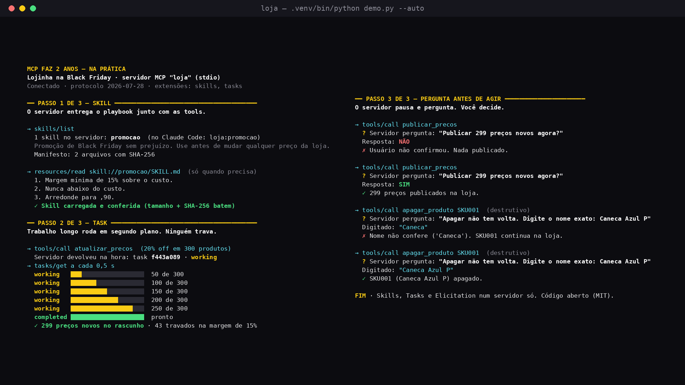

# MCP 2 na prática — a lojinha na Black Friday

[](https://inematds.github.io/mcp2-na-pratica/guia/)

**🇧🇷 [Português](README.md) · 🇺🇸 [English](README.en.md) · 🇪🇸 [Español](README.es.md)** · Licença MIT

## O que é

**Você quer deixar a IA trabalhar nos seus programas sem explicar tudo de novo, sem ficar esperando e sem medo de ela fazer algo que não tem volta.** MCP 2 na prática é um kit gratuito e aberto que mostra isso numa lojinha de mentira com 300 produtos. O MCP (Model Context Protocol) é o padrão aberto que liga a IA ao resto do software; em 24/11/2026 ele ganhou o manual que vem junto, o trabalho em segundo plano e a pergunta antes de agir. Serve para quem usa agentes como o Claude e para quem constrói conectores. "MCP 2.0" é só o apelido que circula: tudo aqui vem do anúncio da Anthropic e do blog oficial do MCP.

## 📖 Guia de uso

Guia completo (landing + passo a passo, sem jargão): **https://inematds.github.io/mcp2-na-pratica/guia/**

## Como começar (sem instalar nada à mão)

Abra o Claude Code (v2.1.331 ou mais novo) ou o Codex e cole:

> Leia o repositório https://github.com/inematds/mcp2-na-pratica (o README, o COMO-LIGAR-NO-CLAUDE.md e a pasta exemplos). Me explique em linguagem simples as três novidades do MCP que ele mostra (o manual que vem junto, o trabalho em segundo plano e a pergunta antes de agir) e o que ainda não foi lançado. Depois olhe os conectores MCP que eu já uso e me diga quais ganham algo com essas novidades. Não instale nem mude nada antes do meu sim. Com o meu sim: baixe o kit numa pasta separada, crie o ambiente, rode os testes e o demo, ligue o servidor "loja" no Claude Code no escopo local, me mostre onde ver /mcp e /skills e, no fim, me diga como tirar.

Não há versão online nem instalador: baixe o [ZIP do kit](https://github.com/inematds/mcp2-na-pratica/archive/refs/heads/main.zip) ou clone o repositório.

---

**Você quer deixar a IA mexer nos preços da sua loja sem medo de estragar tudo?** O MCP fez 2 anos em 24/11/2026 e ganhou o que faltava para isso: a IA recebe o **playbook** junto com as ferramentas, o trabalho demorado roda **em segundo plano**, e o servidor **pergunta antes de agir**.

Este kit mostra as três coisas funcionando de verdade, num servidor MCP pequeno em Python, com uma lojinha de 300 produtos.



## As 4 novidades em uma frase

| Novidade | O que é | Status oficial |
|---|---|---|
| **Skills over MCP** | O servidor entrega skills (o playbook de como usar as tools) junto com as tools; a IA só carrega quando precisa. | **Beta pública.** Claude Code ≥ v2.1.331. Não funciona em `claude -p`. |
| **Tasks** | Trabalho longo vira tarefa em segundo plano: o servidor devolve um `taskId` na hora e o cliente acompanha. | **GA** (disponível) |
| **Elicitation** | O servidor pausa e pergunta ao usuário: formulário (sim/não, digite o nome) ou link para dado sensível fora do chat. | **GA** (disponível) |
| **File Uploads** | Mandar arquivo para o servidor MCP. | **Ainda não lançado** ("rolling out soon"). Este kit só menciona. |

## Instalação técnica

Pré-requisitos: Python 3.10 ou mais novo; para ver a skill no Claude Code, Claude Code v2.1.331 ou mais novo. Abaixo: como rodar, a saída real, os arquivos, o que o SDK faz, os testes e o processo.

## Como rodar (3 comandos)

Precisa de Python 3.10 ou mais novo.

```bash
git clone https://github.com/inematds/mcp2-na-pratica && cd mcp2-na-pratica
python3 -m venv .venv && .venv/bin/pip install -r requirements.txt
.venv/bin/python demo.py --auto
```

Sem `--auto`, o demo pergunta para você (sim/não e o nome do produto). Para rodar os testes: `.venv/bin/python -m pytest -q`.

## Saída real do demo

Copiada de [`exemplos/saida-demo.txt`](exemplos/saida-demo.txt) (as cores ficam no terminal):

```text
MCP FAZ 2 ANOS — NA PRÁTICA
Lojinha na Black Friday · servidor MCP "loja" (stdio)
Conectado · protocolo 2026-07-28 · extensões: skills, tasks

━━ PASSO 1 DE 3 — SKILL ━━━━━━━━━━━━━━━━━━━━━━━━━━━━━━━━━━━━━━━
O servidor entrega o playbook junto com as tools.

→ skills/list
  1 skill no servidor: promocao  (no Claude Code: loja:promocao)
  Promoção de Black Friday sem prejuízo. Use antes de mudar qualquer preço da loja.
  Manifesto: 2 arquivos com SHA-256

→ resources/read skill://promocao/SKILL.md  (só quando precisa)
  1. Margem mínima de 15% sobre o custo.
  2. Nunca abaixo do custo.
  3. Arredonde para ,90.
  ✓ Skill carregada e conferida (tamanho + SHA-256 batem)

━━ PASSO 2 DE 3 — TASK ━━━━━━━━━━━━━━━━━━━━━━━━━━━━━━━━━━━━━━━━
Trabalho longo roda em segundo plano. Ninguém trava.

→ tools/call atualizar_precos  (20% off em 300 produtos)
  Servidor devolveu na hora: task f443a089 · working
→ tasks/get a cada 0,5 s
  working   ███░░░░░░░░░░░░░░░░░  50 de 300
  working   ███████░░░░░░░░░░░░░  100 de 300
  working   ██████████░░░░░░░░░░  150 de 300
  working   █████████████░░░░░░░  200 de 300
  working   █████████████████░░░  250 de 300
  completed ████████████████████  pronto
  ✓ 299 preços novos no rascunho · 43 travados na margem de 15%

━━ PASSO 3 DE 3 — PERGUNTA ANTES DE AGIR ━━━━━━━━━━━━━━━━━━━━━━
O servidor pausa e pergunta. Você decide.

→ tools/call publicar_precos
  ? Servidor pergunta: "Publicar 299 preços novos agora?"
  Resposta: NÃO
  ✗ Usuário não confirmou. Nada publicado.

→ tools/call publicar_precos
  ? Servidor pergunta: "Publicar 299 preços novos agora?"
  Resposta: SIM
  ✓ 299 preços publicados na loja.

→ tools/call apagar_produto SKU001  (destrutivo)
  ? Servidor pergunta: "Apagar não tem volta. Digite o nome exato: Caneca Azul P"
  Digitado: "Caneca"
  ✗ Nome não confere ('Caneca'). SKU001 continua na loja.

→ tools/call apagar_produto SKU001  (destrutivo)
  ? Servidor pergunta: "Apagar não tem volta. Digite o nome exato: Caneca Azul P"
  Digitado: "Caneca Azul P"
  ✓ SKU001 (Caneca Azul P) apagado.

FIM · Skills, Tasks e Elicitation num servidor só. Código aberto (MIT).
```

Um PNG por passo, prontos para vídeo (1920x1080): [`passo1-skill.png`](exemplos/passo1-skill.png), [`passo2-task.png`](exemplos/passo2-task.png), [`passo3-pergunta.png`](exemplos/passo3-pergunta.png).

## O que tem dentro

| Arquivo | Para quê |
|---|---|
| `servidor.py` | Servidor MCP "loja" (stdio): skill `promocao`, tools `atualizar_precos` (task), `publicar_precos` (pergunta sim/não) e `apagar_produto` (digite o nome). |
| `skills/promocao/SKILL.md` | O playbook: margem mínima de 15%, final ,90, nunca abaixo do custo. |
| `demo.py` | Cliente que liga o servidor e mostra os 3 passos no terminal. `--auto` responde sozinho. |
| `loja_cliente.py` | O mínimo de cliente para skills e tasks (usado pelo demo e pelos testes). |
| `tests/` | 17 testes com pytest, todos contra o servidor de verdade (stdio). |
| `exemplos/produtos.csv` | 300 produtos fictícios (gerados por `exemplos/gerar_produtos.py`). |
| `ferramentas/terminal_png.py` | Transforma a saída colorida do demo em PNG 1920x1080. |
| `COMO-LIGAR-NO-CLAUDE.md` | Como ligar o servidor no Claude Code e ver `loja:promocao` em `/skills`. |

O servidor nunca altera `exemplos/produtos.csv`: ele trabalha numa cópia em `trabalho/` (ou na pasta da variável `LOJA_TRABALHO`).

## O que o SDK Python `mcp` 2.3.0 já faz (e o que escrevemos à mão)

Conferido lendo o código do SDK instalado:

| Recurso | No SDK 2.3.0? | Como o kit resolve |
|---|---|---|
| Elicitation (form) | **Sim.** `Resolve` + `Elicit` funcionam no protocolo novo (2026-07-28, pergunta volta como `input_required` e o cliente repete o pedido) e no antigo (pergunta pelo canal de volta). | Usa o SDK direto. Testado nos dois protocolos. |
| Elicitation (url) | Sim (`ctx.elicit_url`). | Só citado: a lojinha não pede dado sensível. |
| Extensões em geral | Sim: `Extension`, `MethodBinding`, `intercept_tool_call` no servidor; `ClientExtension` + `ResultClaim` no cliente. | É a base das duas extensões abaixo. |
| Skills over MCP (`io.modelcontextprotocol/skills`) | **Não** vem pronta. | Escrita em `servidor.py` (`SkillsExtension`): `skills/list`, `skills/get`, arquivos por `resources/read`, `resources/directory/read`, manifesto com SHA-256 e tamanho. |
| Tasks (`io.modelcontextprotocol/tasks`) | **Não** vem pronta (o SDK só tem os tipos antigos de 2025-11-25). | Escrita em `servidor.py` (`TasksExtension`): `CreateTaskResult`, `tasks/get`, `tasks/update`, `tasks/cancel`. Cliente sem a extensão recebe o resultado do jeito antigo, como a spec manda. |
| File Uploads | Não (ainda não lançado). | Só mencionado. |

Limites honestos do kit: as tasks ficam só na memória do servidor (somem se ele reiniciar), o `ttlMs` é informado mas não apaga nada sozinho, e `tasks/update` só confirma o recebimento, porque `atualizar_precos` não pede nada no meio do caminho.

## No Claude Code

Veja [COMO-LIGAR-NO-CLAUDE.md](COMO-LIGAR-NO-CLAUDE.md). Testamos no Claude Code 2.1.332: o servidor conecta pelo protocolo 2026-07-28 e `/skills` lista `loja:promocao` (prova em [`exemplos/prova-claude-code.txt`](exemplos/prova-claude-code.txt)).

## O processo, do início ao fim

Quem faz: 🧠 pessoa · ⚙️ script

1. 🧠 Clonar o repositório: `git clone https://github.com/inematds/mcp2-na-pratica`
2. ⚙️ Criar o ambiente: `python3 -m venv .venv && .venv/bin/pip install -r requirements.txt`
3. ⚙️ (Opcional) Refazer o catálogo de 300 produtos: `.venv/bin/python exemplos/gerar_produtos.py`
4. ⚙️ Rodar os testes: `.venv/bin/python -m pytest -q`
5. ⚙️ Ver o demo: `.venv/bin/python demo.py --auto` (ou sem `--auto` para responder você)
6. 🧠 Ligar no Claude Code: `claude mcp add loja -- $PWD/.venv/bin/python $PWD/servidor.py`, depois `/mcp` e `/skills`
7. ⚙️ (Para vídeo) Gerar os PNGs: `.venv/bin/python demo.py --auto --ritmo 0 > /tmp/demo-cor.txt && python3 ferramentas/terminal_png.py /tmp/demo-cor.txt exemplos/` (precisa de `pip install pillow`)

## Fontes oficiais

- Artigo da Anthropic: <https://claude.com/resources/articles/skills-over-mcp-tasks-and-more>
- Blog do MCP: <https://blog.modelcontextprotocol.io/posts/mcp-turns-two>
- MCP no Claude Code: <https://code.claude.com/docs/en/mcp>
- Extensão Skills: <https://modelcontextprotocol.io/extensions/skills/overview>
- Extensão Tasks: <https://modelcontextprotocol.io/extensions/tasks/overview>
- Elicitation (spec 2026-07-28): <https://modelcontextprotocol.io/specification/2026-07-28/client/elicitation>

## Licença

MIT. Veja [LICENSE](LICENSE). Mais kits como este, grátis no inema.club, direto na internet.
